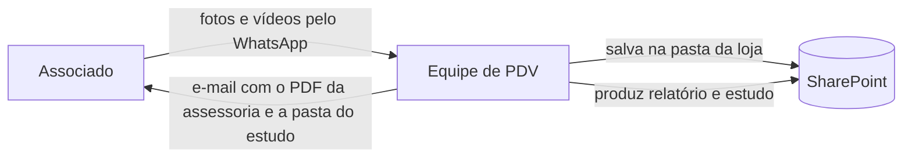
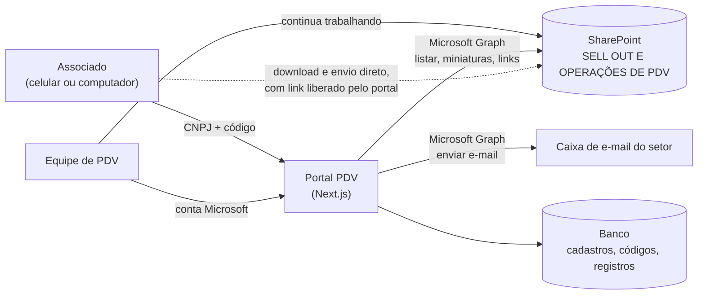
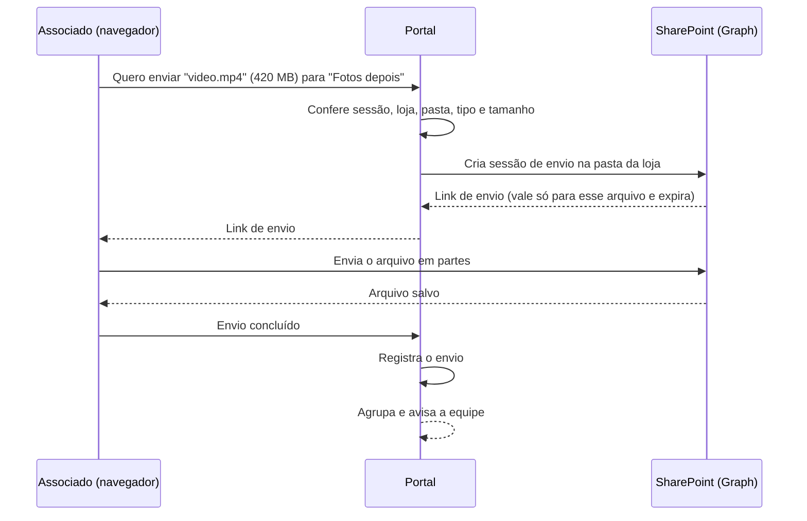

# Portal PDV: documentação do projeto

> **Última atualização:** 18/11/2026
> **Quadro de tarefas:** [PDV - INOVAÇÃO](https://github.com/users/oGuilhermeSoares/projects/3)
> **Design inicial (13/11):** [docs/superpowers/specs/2026-11-13-portal-fotos-pdv-design.md](superpowers/specs/2026-11-13-portal-fotos-pdv-design.md)

Este documento descreve o projeto inteiro: por que ele existe, como o trabalho é feito hoje, o que o portal muda, como ele funciona por dentro e o que ainda falta decidir. Ele vale para a equipe de PDV, que é dona do processo, e para quem desenvolve o portal.

## Sumário

1. [Resumo](#1-resumo)
2. [Como funciona hoje](#2-como-funciona-hoje)
3. [O que muda com o portal](#3-o-que-muda-com-o-portal)
4. [Quem usa](#4-quem-usa)
5. [Objetivos e limites](#5-objetivos-e-limites)
6. [Jornadas](#6-jornadas)
7. [Onde ficam os arquivos (SharePoint)](#7-onde-ficam-os-arquivos-sharepoint)
8. [Arquitetura](#8-arquitetura)
9. [Segurança](#9-segurança)
10. [Dados](#10-dados)
11. [E-mails e avisos](#11-e-mails-e-avisos)
12. [Tecnologia](#12-tecnologia)
13. [Hospedagem](#13-hospedagem)
14. [Plano de trabalho](#14-plano-de-trabalho)
15. [Decisões tomadas](#15-decisões-tomadas)
16. [Perguntas em aberto](#16-perguntas-em-aberto)
17. [Glossário](#17-glossário)

---

## 1. Resumo

O **Portal PDV** é um site onde o associado da Farmácias Associadas acompanha a assessoria de PDV da sua loja. No portal ele:

- vê os **relatórios** que a equipe de PDV produz: o relatório da assessoria e o estudo de mercado;
- vê as **fotos e os vídeos** da loja, de antes e de depois da assessoria;
- **envia novas fotos e vídeos** direto para a equipe, sem passar pelo WhatsApp.

A equipe de PDV continua trabalhando no SharePoint como faz hoje. O portal não guarda arquivos. Ele mostra ao associado as pastas da loja dele e grava nelas o que o associado envia.

---

## 2. Como funciona hoje

Fluxo confirmado pela Camila Couto, do setor de PDV, em 18/11/2026:



1. O associado manda fotos e vídeos da loja pelo **WhatsApp**.
2. A equipe baixa os arquivos do WhatsApp e salva na pasta da loja no SharePoint, em `Fotos antes` ou `Fotos Depois`.
3. A equipe produz os relatórios: o **relatório da assessoria** (um PDF na pasta da loja) e o **estudo de mercado** (a pasta `Estudos`, com PDFs e planilhas BRICK).
4. A equipe envia **por e-mail** o PDF da assessoria e a pasta do estudo de mercado.

Os problemas desse fluxo:

- **Trabalho manual dobrado.** Cada foto e cada vídeo é baixado do WhatsApp e subido no SharePoint, um por um.
- **Perda de qualidade.** O WhatsApp costuma comprimir as fotos. Os arquivos na pasta se chamam `WhatsApp Image 2026-08-10 at 09.41.58.jpeg`, o que mostra que vieram de lá.
- **O associado não tem histórico.** O que ele recebeu está espalhado em e-mails antigos, e as fotos que ele mesmo enviou ficam perdidas na conversa do WhatsApp.
- **Os anexos de e-mail são pesados** e dependem de alguém lembrar de enviar.

---

## 3. O que muda com o portal

| Hoje | Com o portal |
|---|---|
| O associado manda fotos e vídeos pelo WhatsApp | O associado envia pelo portal, e os arquivos caem **direto na pasta da loja no SharePoint**, na qualidade original |
| A equipe baixa do WhatsApp e salva no SharePoint | Os arquivos já chegam no lugar certo, e a equipe **recebe um aviso** de que chegou material novo |
| A equipe envia relatório e estudo por e-mail, como anexo | A equipe salva no SharePoint, como já faz, e clica em **"avisar associado"**. O e-mail leva só o link |
| O associado procura anexos em e-mails antigos | O associado vê **tudo da loja num lugar só**, a qualquer hora, inclusive no celular |

**O que não muda:** a equipe continua usando o SharePoint como hoje, e nenhum arquivo é guardado em dois lugares.

---

## 4. Quem usa

| Perfil | Quem é | Como entra | O que faz |
|---|---|---|---|
| **Associado** | O dono da farmácia. Pode ter mais de uma loja, ou seja, mais de um CNPJ | Digita o CNPJ e recebe um código de 6 dígitos no e-mail cadastrado | Vê relatórios, estudo, fotos e vídeos das suas lojas e envia fotos e vídeos |
| **Equipe de PDV** | O setor SELL OUT E OPERAÇÕES DE PDV (contato: Camila Couto) | Conta Microsoft `@farmaciasassociadas.com.br` | Cadastra associados, liga cada associado à pasta da loja, recebe os avisos de envio e avisa o associado quando há material novo |
| **Equipe técnica** | Guilherme Soares e William | — | Constrói e mantém o portal |

---

## 5. Objetivos e limites

### Objetivos

- O associado vê o material das suas lojas, organizado e no celular.
- O associado envia fotos e vídeos sem o WhatsApp, e os arquivos chegam direto na pasta certa.
- A equipe de PDV **não muda a rotina** no SharePoint.
- A equipe fica sabendo, sem precisar procurar, quando o associado envia material.
- A equipe tem uma área de administração para cadastrar associados e acompanhar os acessos.

### Fora do escopo, por agora

- O associado não apaga, renomeia nem move arquivos. Proposta: se precisar, ele pede à equipe.
- O portal não substitui o SharePoint como repositório da equipe.
- Não há chat nem comentários nos arquivos.
- O portal não gera relatórios. Eles continuam sendo produzidos pela equipe.

### Seria um fracasso, mesmo "funcionando"

- Um associado conseguir ver o material de outra loja.
- Alguém entrar só sabendo o CNPJ, que é público.
- A equipe ter de manter os arquivos em dois lugares.
- O associado enviar fotos e ninguém da equipe perceber.
- O associado ver um relatório que a equipe ainda não terminou.

---

## 6. Jornadas

### 6.1 O associado entra no portal

1. Digita o CNPJ de uma das suas lojas, com ou sem pontuação.
2. Recebe um código de 6 dígitos no e-mail cadastrado. A tela mostra o e-mail mascarado (`jo***@gmail.com`) para ele saber onde procurar.
3. Digita o código e fica logado por **30 dias** naquele aparelho.
4. Vê **todas as lojas do seu grupo**, mesmo tendo entrado com o CNPJ de uma só.

### 6.2 O associado vê o material da loja

Esboço da tela no celular:

```
┌────────────────────────────────────┐
│ [logo] Portal PDV            Sair  │
│ Drogaria Jumalti - Caxias do Sul ▾ │
├────────────────────────────────────┤
│ [ + Enviar fotos e vídeos ]        │
├────────────────────────────────────┤
│ Relatórios                         │
│  [PDF] Assessoria GC - Jumauti     │
│        atualizado em 28/10         │
├────────────────────────────────────┤
│ Estudo de mercado                  │
│  [PDF]  BRICK 2004 - Jumauti       │
│  [PDF]  BRICK 2004 - Farm. Geral   │
│  [XLSX] Produtos Jumauti           │
│  [XLSX] Produtos Farm. Geral       │
├────────────────────────────────────┤
│ Fotos e vídeos: antes              │
│  ▢ ▢ ▢ ▢   (16 itens)  ver todos › │
├────────────────────────────────────┤
│ Fotos e vídeos: depois             │
│  ▢ ▢ ▢     (3 itens)   ver todos › │
└────────────────────────────────────┘
```

- Fotos abrem em tela cheia, com setas no computador e arrasto no celular.
- Vídeos tocam no navegador e PDFs abrem no navegador. Planilhas são baixadas.
- O seletor no topo aparece quando o associado tem mais de uma loja.

### 6.3 O associado envia fotos e vídeos

1. Toca em **Enviar fotos e vídeos**. No celular, isso abre a galeria ou a câmera.
2. Escolhe a loja, se tiver mais de uma, e se o material é de **antes** ou de **depois** da assessoria. Essa escolha ainda está em aberto: veja a [pergunta 1](#16-perguntas-em-aberto).
3. Seleciona um ou vários arquivos e acompanha uma barra de progresso para cada um.
4. Os arquivos entram na pasta da loja no SharePoint. Se já existir um arquivo com o mesmo nome, o novo é renomeado e nada é sobrescrito.
5. A equipe recebe um aviso único para o envio inteiro, por exemplo: "Drogaria Jumalti enviou 12 fotos e 1 vídeo".

### 6.4 A equipe publica um relatório e avisa o associado

1. A equipe salva o relatório ou o estudo na pasta da loja no SharePoint, como já faz hoje.
2. No portal, abre o associado e clica em **Avisar associado**. Se quiser, escreve uma mensagem.
3. O associado recebe um e-mail com o link do portal, sem anexo.

### 6.5 A equipe cadastra um associado

1. Na área de admin, cria o associado com nome e e-mails, e adiciona as lojas com CNPJ, razão social e cidade.
2. Clica em **Escolher pasta** e navega até a pasta da loja em `LOJAS ATENDIDAS`.
3. Confere a **prévia**, que mostra exatamente o que o associado vai ver.
4. Para muitas lojas de uma vez, a equipe pode importar uma planilha (card #15).

---

## 7. Onde ficam os arquivos (SharePoint)

- **Site:** SELL OUT E OPERAÇÕES DE PDV (`/sites/SELLOUTEOPERAESDEPDV`), grupo privado.
- **Caminho:** `Documentos / ASSESSORIA GC / LOJAS ATENDIDAS / <Nome da loja - Cidade>`

Exemplo real de uma loja:

```
LOJAS ATENDIDAS/
└── Drogaria Jumalti - Caxias do Sul/
    ├── Assessoria GC - Jumauti Ltda (1).pdf          ← relatório da assessoria
    ├── Estudos/                                      ← estudo de mercado
    │   ├── BRICK 2004 - Drogaria Jumauti Ltda - MAT04_2026.pdf
    │   ├── BRICK 2004 - Farmacia Geral Ltda - MAT04_2026.pdf
    │   ├── BRICK 2004 - PRODUTOS FARM GERAL - MAT04_2026.xlsx
    │   └── BRICK 2004 - PRODUTOS JUMAUTI - MAT04_2026.xlsx
    ├── Fotos antes/                                  ← vieram do associado pelo WhatsApp
    │   ├── Vídeo.mp4
    │   └── WhatsApp Image 2026-08-10 at 09.41.58.jpeg  (e várias outras)
    └── Fotos Depois/
        ├── Medicamentos 1.jpeg
        ├── Medicamentos 2.mp4
        └── Medicamentos.jpeg
```

Como o portal lê as pastas:

| No SharePoint | No portal |
|---|---|
| Arquivos soltos na pasta da loja | **Relatórios** |
| `Estudos` | **Estudo de mercado** |
| `Fotos antes` | **Fotos e vídeos: antes** |
| `Fotos Depois` | **Fotos e vídeos: depois** |
| Qualquer outra subpasta | Aparece com o próprio nome, no fim |
| Subpasta `Interno` (proposta) | **Não aparece.** É o lugar dos rascunhos da equipe |

Regras importantes:

- **O vínculo usa o ID da pasta, não o nome.** A pasta se chama "Jumalti" e os arquivos dizem "Jumauti", o que parece um erro de digitação. Corrigir o nome no SharePoint não quebra o portal.
- Os nomes das seções são comparados **sem diferenciar maiúsculas e acentos**. Assim, `Fotos Depois` e `Fotos depois` são a mesma seção.
- O associado só enxerga as pastas ligadas a ele.

---

## 8. Arquitetura



| Peça | Para que serve |
|---|---|
| **Portal (Next.js)** | Telas, login e todas as regras de quem pode ver e enviar o quê |
| **Banco** | Associados, lojas, vínculos com as pastas, códigos de acesso e registros de acessos e envios. Não guarda arquivos |
| **App "Portal PDV" no Entra** | A identidade do portal dentro do Microsoft 365 |
| **Microsoft Graph: arquivos** | Listar pastas, gerar miniaturas, baixar e enviar arquivos |
| **Microsoft Graph: e-mail** | Enviar o código de acesso e os avisos pela caixa do setor |

**Os arquivos não passam pelo servidor do portal.** Para baixar ou enviar, o portal confere a permissão e gera um link curto do SharePoint. O navegador então fala direto com o SharePoint. Com isso:

- o servidor fica leve e barato, o que é bom para qualquer hospedagem (veja a [seção 13](#13-hospedagem));
- vídeos grandes não esbarram no limite de tamanho de requisição da hospedagem;
- o portal só aceita o envio depois de conferir quem é o associado e qual é a pasta.

### Como é o envio de um arquivo grande



---

## 9. Segurança

**Login do associado**
- O CNPJ é público, então **sozinho ele não dá acesso**. É preciso também o código enviado ao e-mail cadastrado.
- O código vale **10 minutos** e aceita no máximo **5 tentativas**. Cada CNPJ pode pedir no máximo **3 códigos a cada 15 minutos**, e também há limite por IP.
- No banco fica só o hash do código, e cada código vale uma vez.
- A sessão dura 30 dias, e o associado pode sair a qualquer momento.
- Se o CNPJ não estiver cadastrado ou o associado estiver desativado, nenhum e-mail é enviado.

**Login da equipe**
- Entra pelo SSO da Microsoft, e só contas `@farmaciasassociadas.com.br` liberadas na lista de admins.
- A sessão de associado nunca abre a área de admin.

**Ver e baixar arquivos**
- Cada pedido de arquivo passa por uma rota do portal. Ela confere a sessão e se o arquivo está **dentro de uma pasta ligada àquele associado**. Só então redireciona para um link curto do SharePoint.
- Nenhum link do SharePoint vai para a página sem essa checagem.

**Enviar arquivos**
- O portal só cria a sessão de envio **na pasta de uma loja do próprio associado**.
- O link de envio grava **um arquivo só**, no nome e na pasta que o portal definiu, e expira.
- O portal aceita só os tipos combinados: fotos JPG, PNG e HEIC, e vídeos MP4 e MOV. O tamanho máximo ainda vai ser definido (veja a [pergunta 5](#16-perguntas-em-aberto)).
- Arquivos com o mesmo nome **nunca são sobrescritos**. O novo é renomeado.

**Permissões no Microsoft 365**
- O app do portal tem a permissão `Sites.Selected` **apenas no site do setor de PDV**, com papel de **escrita**, porque precisa gravar os envios. Os outros sites do tenant ficam inacessíveis.
- A permissão `Mail.Send` fica restrita à caixa do setor por Application Access Policy.
- Os segredos (client secret, banco) ficam só nas variáveis de ambiente, nunca no repositório.

---

## 10. Dados

O banco guarda **cadastros e registros, nunca arquivos**.

| Tabela | O que guarda |
|---|---|
| `Associado` | O grupo: nome, ativo/inativo e e-mails de contato |
| `Loja` | CNPJ (único, só os dígitos), razão social, nome fantasia e cidade. Pertence a um associado |
| `VinculoPasta` | Liga o associado, e opcionalmente uma loja, a uma pasta do SharePoint pelo `driveId` + `itemId`. Guarda também o nome da pasta, só para exibir |
| `CodigoAcesso` | Hash do código, validade, tentativas, data de uso e IP |
| `Admin` | Pessoas da equipe liberadas na área de admin |
| `RegistroAcesso` | Logins do associado e arquivos abertos ou baixados |
| `EnvioAssociado` | Arquivos enviados pelo associado: loja, seção, nome, tamanho, ID no SharePoint e data |
| `AvisoEnviado` | E-mails "material novo" enviados ao associado: quem enviou e quando |

O banco começa local no desenvolvimento. Postgres ou MySQL é decidido junto com a hospedagem, e o código não usa recurso exclusivo de nenhum dos dois.

---

## 11. E-mails e avisos

Todos saem pelo **Microsoft Graph**, a partir de uma caixa do setor que ainda vai ser definida. É o mesmo caminho que o FarmaDesk usa.

| Aviso | Para quem | Quando |
|---|---|---|
| **Código de acesso** | Associado | Quando ele pede para entrar |
| **Material novo disponível** | Associado | Quando a equipe clica em "avisar associado". Substitui o e-mail com o PDF e o estudo anexados |
| **O associado enviou fotos e vídeos** | Equipe de PDV | Depois de um envio, num aviso único para o envio inteiro |
| **Aviso automático de material novo** (futuro) | Associado | Quando a equipe sobe arquivo novo no SharePoint (card #18) |

Os e-mails usam a identidade visual da Farmácias Associadas e sempre têm uma versão em texto simples.

---

## 12. Tecnologia

É a mesma base dos outros sistemas internos (FarmaDesk e Inventário). Assim a equipe reaproveita o que já sabe e o que já está pronto.

| Item | Escolha |
|---|---|
| Aplicação | Next.js 16 (App Router, `proxy.ts`), React 19, TypeScript |
| Banco | Prisma 7, com Postgres ou MySQL conforme a hospedagem |
| Login da equipe | Auth.js v5 com Microsoft Entra ID |
| Login do associado | CNPJ + código por e-mail, implementado no próprio portal |
| Arquivos e e-mail | Microsoft Graph, com o app "Portal PDV" no Entra |
| Visual | Tailwind v4, com os tokens da marca: teal `#00b6ad` e laranja `#f97316` |
| Validação | zod |

A identidade visual segue a da Farmácias Associadas: cores, logo e nada de emoji no lugar de ícone.

---

## 13. Hospedagem

**Em aberto. A decisão é do William, no card #2.**

Como os arquivos ficam no SharePoint e não passam pelo servidor, o portal precisa só de **um servidor Node.js e de um banco pequeno**.

| Opção | Banco | Observação |
|---|---|---|
| Hostinger, "Node.js Web Apps" (plano Business ou maior) | MySQL gerenciado | Roda o Next.js. O app dorme quando fica parado, e o primeiro acesso depois disso é mais lento |
| Hostinger VPS | Postgres instalado na VPS | Controle total, mas a manutenção do servidor fica com a equipe |
| Vercel + Supabase | Postgres | O caminho do FarmaDesk e do Inventário |

Para o domínio, a sugestão é seguir o padrão `*.redeassociadas.com.br`, por exemplo `pdv.redeassociadas.com.br`.

---

## 14. Plano de trabalho

Cada tarefa é um card no [quadro PDV - INOVAÇÃO](https://github.com/users/oGuilhermeSoares/projects/3) e uma issue neste repositório. A situação abaixo é a de 18/11/2026.

### Etapas

| Etapa | Cards | Resultado |
|---|---|---|
| **1. Base** | #1, #2, #3, #5 | Projeto criado, hospedagem decidida, acesso ao Microsoft 365 liberado, banco modelado |
| **2. O associado vê o material** | #4, #6, #7, #8, #9, #10, #11, #12 | Equipe cadastra; associado entra e vê relatórios, estudo, fotos e vídeos |
| **3. O associado envia fotos** | cards novos (veja abaixo) | Associado envia pelo portal, e a equipe é avisada |
| **4. No ar** | #13 | Portal publicado |
| **5. Melhorias** | #14 a #18 | Avisar o associado, importar planilha, registro de acessos, zip, aviso automático |

### Cards atuais

| # | Card | Situação | Prioridade | Tamanho | Responsável |
|---|---|---|---|---|---|
| #1 | Configurar o projeto | Pronto para começar | Alta | Médio | Guilherme |
| #2 | Decidir a hospedagem e o banco | Pronto para começar | Alta | Pequeno | William (sugerido) |
| #3 | Registrar o app no Entra | Pronto para começar | Alta | Pequeno | Guilherme |
| #4 | Cliente do Microsoft Graph | A fazer | Alta | Médio | Guilherme |
| #5 | Modelo de dados | A fazer | Alta | Pequeno | — |
| #6 | Login do setor com a conta Microsoft | A fazer | Alta | Médio | — |
| #7 | Admin: cadastro de associados e lojas | A fazer | Alta | Médio | — |
| #8 | Admin: ligar a pasta do SharePoint | A fazer | Alta | Médio | — |
| #9 | Envio de e-mails pela caixa do setor | A fazer | Alta | Pequeno | — |
| #10 | Login do associado: CNPJ + código | A fazer | Alta | Grande | — |
| #11 | Área do associado | A fazer | Alta | Grande | — |
| #12 | Acesso protegido aos arquivos | A fazer | Alta | Pequeno | — |
| #13 | Publicar o portal | A fazer | Alta | Médio | — |
| #14 | Botão "avisar associado" | A fazer | Média | Pequeno | — |
| #15 | Importar associados por planilha | A fazer | Média | Médio | — |
| #16 | Registro de acessos | A fazer | Média | Pequeno | — |
| #17 | Baixar tudo em .zip | A fazer | Média | Médio | — |
| #18 | Aviso automático de arquivo novo | A fazer | Baixa | Grande | — |

**Prioridade:** Alta é o que precisa para o portal entrar no ar, Média vem logo depois do lançamento e Baixa é melhoria futura.
**Tamanho:** Muito pequeno leva algumas horas, Pequeno cerca de 1 dia, Médio de 2 a 3 dias, Grande cerca de 1 semana, e Muito grande mais que isso.

### Ajustes no quadro por causa do retorno da Camila (18/11)

Os cards foram escritos antes do retorno da Camila. Ainda falta aplicar no quadro:

- **#3:** a permissão no site passa de **leitura** para **escrita**, porque o portal vai gravar os envios do associado.
- **#11:** o texto fala em "substituir o zip". Passa a ser "mostrar relatórios, estudo, fotos e vídeos". Também entra a seção **Relatórios** para os arquivos soltos na pasta.
- **#14:** o aviso substitui o e-mail com **o PDF da assessoria e a pasta do estudo**, e não um zip.
- **#17:** rever a prioridade, já que hoje ninguém recebe um zip com tudo.
- **Card novo: "Associado envia fotos e vídeos pelo portal"** (Alta, Grande). Inclui a tela de envio, a sessão de envio do Graph direto do navegador, o progresso por arquivo, os tipos e o tamanho permitidos, o tratamento de nomes repetidos e o registro em `EnvioAssociado`. Antes de começar, vale um teste rápido para confirmar que o navegador consegue enviar direto para o link do SharePoint.
- **Card novo: "Avisar a equipe quando o associado enviar fotos e vídeos"** (Alta, Pequeno). Um aviso único por envio.

---

## 15. Decisões tomadas

| Data | Decisão | Quem decidiu |
|---|---|---|
| 13/11/2026 | Os arquivos ficam **no SharePoint** e o portal lê e grava direto lá. Não há cópia em outro armazenamento | Guilherme |
| 13/11/2026 | O associado entra com **CNPJ + código de 6 dígitos no e-mail**, sem senha | Guilherme |
| 13/11/2026 | **Um associado pode ter várias lojas.** Exemplo: a Drogaria Jumauti e a Farmácia Geral são do mesmo associado | Guilherme |
| 13/11/2026 | A tecnologia é a mesma dos outros sistemas (Next.js, Prisma, Auth.js e Tailwind) | Guilherme |
| 13/11/2026 | A hospedagem fica em aberto, e quem decide é o William | Guilherme |
| 13/11/2026 | O repositório é público, e dados reais podem aparecer nos cards e na documentação | Guilherme |
| 13/11/2026 | O quadro fica todo em português | Guilherme |
| 18/11/2026 | Hoje, só os relatórios (o PDF da assessoria e o estudo de mercado) vão por e-mail. As fotos e os vídeos chegam do associado pelo WhatsApp | Camila |
| 18/11/2026 | **O associado também envia fotos e vídeos pelo portal** | Camila |
| 18/11/2026 | Proposta: os envios vão direto do navegador para o SharePoint, com link liberado pelo portal | Equipe técnica (a confirmar no card novo) |

---

## 16. Perguntas em aberto

| # | Pergunta | Para quem | Proposta | O que muda |
|---|---|---|---|---|
| 1 | Quando o associado envia fotos, **ele escolhe** "antes" ou "depois", ou tudo vai para uma pasta "Enviadas pelo associado" que a equipe organiza? | Camila | Ele escolhe, e o arquivo vai direto para `Fotos antes` ou `Fotos Depois` | A tela de envio e o trabalho de organização da equipe |
| 2 | Um arquivo novo na pasta da loja **já aparece** para o associado, ou a equipe precisa liberar? | Camila | Aparece na hora. Rascunhos ficam numa subpasta `Interno`, que o portal ignora | Se existe ou não um botão de "publicar" |
| 3 | Quem recebe o aviso de que o associado enviou fotos: a caixa de e-mail do setor ou um canal do Teams? | Camila | E-mail para a caixa do setor | O card de aviso para a equipe |
| 4 | O associado pode **apagar** algo que ele mesmo enviou por engano? | Camila | Não. Ele pede à equipe | A permissão e a tela do associado |
| 5 | Qual é o **tamanho máximo** de um vídeo? | Camila e William | Até 1 GB por arquivo | As regras do envio |
| 6 | Durante a transição, o associado **continua podendo mandar pelo WhatsApp**? | Camila | Sim, por alguns meses, com a equipe indicando o portal | A comunicação com os associados |
| 7 | Qual **caixa de e-mail** do setor envia os códigos e os avisos? | Guilherme e Camila | Uma caixa do setor, como `pdv@farmaciasassociadas.com.br` | O card #3 e o card #9 |
| 8 | Onde vamos **hospedar** e com qual banco? | William | Veja a [seção 13](#13-hospedagem) | Os cards #2 e #13 |
| 9 | Existe uma **lista dos associados** com CNPJs, e-mails e pastas? Quantas lojas são atendidas hoje? | Camila | Montar uma planilha para importar | O card #15 e a data de lançamento |

---

## 17. Glossário

| Termo | Significado |
|---|---|
| **Associado** | O dono da farmácia que faz parte da Farmácias Associadas. Pode ter várias lojas |
| **Loja** | Cada farmácia do associado. É identificada pelo CNPJ |
| **Setor de PDV** | O setor SELL OUT E OPERAÇÕES DE PDV, que faz a assessoria nas lojas |
| **Assessoria GC** | O trabalho de assessoria que o setor faz na loja, registrado no relatório "Assessoria GC - <loja>.pdf" |
| **Estudo de mercado / BRICK** | O estudo da região da loja, na pasta `Estudos`. "Brick" é a divisão geográfica usada em dados do mercado farmacêutico. "MAT04_2026" indica, ao que tudo indica, os 12 meses acumulados até abril de 2026 (a confirmar com a Camila) |
| **Fotos antes / Fotos depois** | Fotos e vídeos da loja de antes e de depois da assessoria |
| **SharePoint** | Onde a equipe guarda os arquivos de cada loja |
| **Microsoft Graph** | A forma oficial de um sistema ler e gravar arquivos e enviar e-mails no Microsoft 365 |
| **Entra ID** | O cadastro de usuários e aplicativos da Microsoft. É onde o portal ganha permissão para acessar o SharePoint |
| **Sites.Selected** | Um tipo de permissão que dá ao portal acesso a **um site específico**, e não a todo o SharePoint da empresa |
| **Sessão de envio** | Um link temporário do SharePoint que permite gravar um arquivo grande em partes |

---

## Histórico deste documento

| Data | Mudança |
|---|---|
| 13/11/2026 | [Design inicial](superpowers/specs/2026-11-13-portal-fotos-pdv-design.md) e criação dos 18 cards |
| 18/11/2026 | Documentação completa do projeto. Incorpora o retorno da Camila: o fluxo de hoje com WhatsApp e e-mail, e o envio de fotos e vídeos pelo associado |
